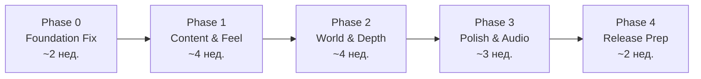

# My Little Farm — Road to Release
### От текущего состояния до готового продукта уровня Steam/Epic Games Store

> [!IMPORTANT]
> Этот план составлен на основе: GDD v0.1, плана разработки (сентябрь–декабрь 2026), gameplay review от 08.10.2026, анализа структуры кода (`_Game/Core`, `_Game/Gameplay`, `_Game/UI`) и набора ассетов (LowPolyFarmLite, LowPolyFoodLite, Pandazole Ultimate Pack, Stylized NPC Peasant Nolant). Это не академический MVP — цель продукт, который **стыдно не купить за 5–10 USD в Steam**.

---

## Что уже есть (текущее состояние, октябрь 2026)

```
✅ Работающая архитектура        GridSystem, ChunkData, TilemapChunk, WorldMapAsset
✅ Core farming loop             CropSystem, CropDefinition, CropRuntimeState, CropView
✅ 6 культур в контенте          carrot, corn, cucumber, potato, tomato, wheat
✅ Деревья                       OrchardSystem, TreeDefinition, TreeView (apple.asset)
✅ Животные                      AnimalSystem, AnimalDefinition, AnimalRuntimeState
✅ Экономика                     WalletSystem, InventorySystem, SellingSystem, SeedShopSystem
✅ Строительство                 BuildSystem, BuildingDefinition, BuildingView, BuldingLayout
✅ URP-рендер, low-poly ассеты   LowPolyFarmLite + LowPolyFoodLite + Pandazole
✅ Save/Load                     SaveSystem, SaveData
✅ UI                            HUDController, InteractionPromptUI, ActionFeedbackSystem
✅ Onboarding                    OnboardingSystem
✅ Тесты                         EditMode + PlayMode suite (15+ тест-файлов)
✅ Камера                        IsometricCameraController (плавный zoom/rotate — оценён позитивно)
```

**Подтверждённые проблемы из gameplay review (октябрь 2026):**
- Земля визуально ниже физической плоскости (offset −0.4)
- Стадии роста культур назначают один и тот же maturePrefab для всех фаз
- HUD рассогласован между Edit Mode и Play Mode
- Строительная подсказка обрезает нижние строки (высота 56 единиц — мало)
- Hover-выбор объектов смотрит на землю, а не на животных/деревья
- Масштаб построек несогласован с персонажем
- Run/Jump — только ускоренная анимация ходьбы, нет отдельных состояний

---

## Куда нужно прийти — целевой образ готового продукта

Referenсы уровня бюджета: **Stardew Valley, Hokko Life, Dinkum, Garden Life, Sun Haven** (все вышли на Steam за 10–20 USD, low/mid-poly, solo или micro-команды).

Минимальные признаки «настоящего» продукта:
- ≥ 3–5 часов полноценного первого прохождения (не grinding, а открытия)
- Законченный визуальный стиль без placeholder-ощущения
- Звук + музыка с настройкой громкости
- Main menu, Settings, Credits, Pause
- Achievements (Steam) или локальные
- Стабильные 60 FPS на среднем ноутбуке 2022 года
- Отсутствие blocker и критических UX-ошибок на 4-часовом прохождении
- Законченный Steam Store Page (capsule art, screenshots, trailer, description)

---

## Структура плана: 5 этапов

**Правило проверок от пользователя (21.10.2026):** автоматические тесты выполняем только при закрытии крупных фаз Phase 0, Phase 1, Phase 2 и далее. После отдельных пунктов P0-4, P0-5 и т. п. тесты не запускаем; достаточно проверки компиляции и короткой визуальной/ручной проверки. Подготовленные тестовые сценарии ожидают завершения фазы. Исключение — отдельный явный запрос пользователя на более ранний прогон.



Общий горизонт: **~15 недель** от сегодня (ноябрь 2026 → февраль 2027).

---

## Phase 0 — Foundation Fix (2 недели)
### Цель: убрать все известные визуальные и физические ошибки, чтобы не полировать сломанное

> [!WARNING]
> Это обязательная фаза. Пропуск её означает, что любая полировка контента будет строиться на неправильных коллайдерах, масштабах и анимациях.

### P0-1 · Земля и физическая плоскость
- [x] Зафиксировать `Ground Visual` offset: совместить `Renderer.bounds.max.y` с Y = 0
- [x] Проверить ноги персонажа, куриц, основания всех зданий, тени после исправления
- [x] Добавить редактор-утилиту (`Editor/GroundAlignmentValidator.cs`) для автоматической проверки

Выполнено 20.10.2026. Проверены 9 чанков, ноги персонажа и куриц, 5 типов построек во всех четырёх поворотах и тени в Play Mode. Отчёт: [P0-1](../Verification/P0-1/report.md).

### P0-2 · Стадии роста культур
- [x] Создать отдельные префабы стадий для каждой культуры (минимум 3 фазы: росток, средняя, зрелая)
- [x] Исправить `Editor/ImportedArtSetup.cs`: убрать назначение maturePrefab в все stagePrefabs
- [x] Кукуруза: заменить декоративную траву на правильную модель кукурузного стебля
- [x] `CropView`: масштаб стадий должен быть пропорционален, не дублировать размер зрелого растения
- [x] Помидор использовать как эталон — он уже работает корректно

Выполнено 20.10.2026. Для шести культур сохранены 18 префабов, у кукурузы — стебель, листья, початки и метёлка. Зрелый помидор сохранён как эталон. Проверены размеры, смена стадий, восстановление посевов и сбор урожая. [Отчёт P0-2](../Verification/P0-2/report.md).

### P0-3 · Масштаб персонажа и построек
- [x] Определить единицу масштаба: 1 клетка = 1 Unity unit; персонаж = 1.8 units высотой
- [x] Перепроверить и пересмотреть footprint всех построек (`BuildingDefinition`) относительно этой единицы
- [x] Курятник, склад, дом — масштаб по высоте двери = рост персонажа × 1.1
- [x] `BuildingView`: согласовать BoxCollider с итоговыми bounds модели, а не с footprint-прямоугольником
- [x] Клумба: заменить декоративную траву на правильный объект

Выполнено 21.10.2026. Дом 7×6, склад 5×6, рынок 8×5, курятник 3×5, клумба 1×1. Двери дома, склада и служебная дверь курятника имеют высоту 1.98. По дополнительному запросу основным персонажем стал Kevin Iglesias Human Basic Motions FREE: Humanoid высотой 1.8, 34 клипа, отдельные Walk/Run/Sprint, направленное движение, прыжок и дополнительные позы. Сохранения v7 мигрируют прежние footprint без удаления содержимого. [Отчёт P0-3](../Verification/P0-3/report.md).

### P0-4 · HUD и UI согласованность
- [x] `ResponsiveHudLayout`: переписать preview на `[ExecuteAlways]` без вызова runtime-инициализации
- [x] Строительная подсказка: выделить в отдельный UI-элемент с фиксированной высотой ≥ 120 units
- [x] Показывать все строки: подтвердить (E), повернуть (Q/R), отмена (Esc)
- [x] Build preview: помимо зелёного/красного прямоугольника показывать полупрозрачный силуэт модели

Выполнено 21.10.2026. В редакторе доступны иллюстративные Exploration / BuildAllowed / BuildBlocked без инициализации фермы. Строительная карточка `Build Prompt` имеет постоянную высоту 180 units и показывает все команды. Q и R вращают постройку; Q в этом режиме не вращает камеру. У всех пяти моделей — полупрозрачный зелёный/красный силуэт без коллайдеров и теней. Проверены 1280×720, 1920×1080, 2560×1440 и 1280×800. [Отчёт P0-4](../Verification/P0-4/report.md).

### P0-5 · Hover и interaction
- [x] `CellSelector`: добавить raycast-слой для животных, деревьев и торговых точек с приоритетом над землёй
- [x] `InteractionSystem`: показывать outline только на реальном объекте под курсором, а не на клетке под ним
- [x] Стабилизировать подсказку: она не должна мигать при каждом микродвижении мыши

Выполнено 21.10.2026. Слой `FarmInteraction` и отдельный объектный raycast выбирают цель перед землёй; под объектом маркер клетки выключен. Текст меняется после 0.12 секунды устойчивого hover, включая уход с цели; движение той же курицы между клетками таймер не сбрасывает. Во время переключения E/ЛКМ защищены от случайного действия. Выполнены компиляция и короткий визуальный осмотр; автоматические тесты отложены до конца Phase 0. [Отчёт P0-5](../Verification/P0-5/report.md).

### P0-6 · Анимации персонажа
- [x] Проверить Pandazole/Stylized NPC Peasant Nolant — есть ли там Run и Jump клипы
- [x] В активном `KevinLocomotion.controller` (заменил прежний `PlayerLocomotion.controller`) добавить отдельное состояние Run по порогу скорости, не ускорять Walk
- [x] Использовать настоящий Jump у Kevin; legacy Nolant без Jump оставить с нейтральной Idle-позой в воздухе и зафиксировать в backlog

P0-6 реализован 21.10.2026. В установленном Pandazole — 0 AnimationClip, в Nolant — только Idle и Walk. Основной персонаж Kevin сохранён: 34 клипа, отдельные Run и Jump. Состояние Run включается при Speed > 3.2 и выходит при Speed < 3.0; выбор походки зависит от фактической скорости. Полные проверки Phase 0: 37/37 EditMode и 39/39 PlayMode. Проверка 30-минутного критерия остановлена пользователем после 14 минут; критерий выхода пока не закрыт. Финальный статус — [отчёт Phase 0](../Verification/Phase0/report.md).

**Критерий выхода из P0:** визуальный тест 30 минут без земельных артефактов, с правильными стадиями роста, без обрезанного UI, без мигания подсказок.

---

## Phase 1 — Content & Feel (4 недели)
### Цель: наполнить игру до уровня «в это интересно играть 2–3 часа»

### P1-1 · Расширение контента культур
| Культура | Статус | Действие |
|---|---|---|
| Морковь | ✅ | Проверить стадии, финализировать |
| Пшеница | ✅ | Проверить, добавить анимацию колыхания |
| Кукуруза | ⚠️ | Исправить модели (P0-2) |
| Помидор | ✅ | Эталон, финализировать |
| Картофель | ⚠️ | Исправить стадии (P0-2) |
| Огурец | ⚠️ | Исправить стадии (P0-2) |
| Клубника | ❌ | Добавить (repeatable harvest) |
| Тыква | ❌ | Добавить (долгий цикл, высокая цена) |

- [ ] Реализовать повторный урожай (`repeatable = true`) для клубники и томатов
- [ ] Добавить эффект колыхания растений (`CropView`: простой синусоидальный scale/rotate через `Update`)
- [ ] Плоды на деревьях: `TreeView` — перекрасить зрелые яблоки в красный (`FruitReadyColor`)
- [ ] Добавить вторую культуру-дерево: груша

### P1-2 · Животные — завершение и расширение
- [ ] Куры: проверить и починить idle/walk/eat состояния NavMesh внутри загона
- [ ] Куры: иконка «яйцо готово» над головой (world-space UI)
- [ ] **Коровы** — добавить как следующее животное:
  - `AnimalDefinition` для коровы
  - Продукт: молоко (новый `ItemDefinition`)
  - Коровник (`BuildingDefinition` 3×4 клетки)
  - Состояния: Idle → Walk → Eat → Produce → ReadyToCollect
- [ ] Кормушка: здание-апгрейд, увеличивает интервал ручного кормления

### P1-3 · Производственные цепочки (первый уровень)
- [ ] Мельница: пшеница → мука (время переработки: 90 сек, цена муки × 2.5)
- [ ] Сыроварня: молоко → сыр (× 3)
- [ ] Яблочный пресс: яблоки → сок (× 2)
- [ ] UI производственной постройки: слот «сырьё», прогресс-бар, слот «продукт»
- [ ] Предотвратить overflow: если слот продукта полон — производство останавливается с уведомлением

### P1-4 · Инвентарь — полный UX
- [ ] Экран инвентаря (клавиша I/Tab): сетка с крупными иконками
- [ ] Drag-and-drop между слотами инвентаря и быстрыми слотами
- [ ] Стаки: семена, урожай, материалы — стекируются; инструменты — нет
- [ ] Кнопка «Переместить всё в склад»
- [ ] Сортировка по типу (категория предмета)
- [ ] Инструменты в выделенных постоянных слотах (не занимают обычный инвентарь)

### P1-5 · Магазин и торговля — UX-полировка
- [ ] UI магазина: карточки товаров с иконкой, названием, ценой, количеством
- [ ] Предпросмотр суммы перед покупкой
- [ ] Продажная точка: выбрать конкретные товары и количество (не «продать всё автоматом»)
- [ ] Ежедневные заявки рынка: «Нужно 5 моркови сегодня — бонус +30%»

### P1-6 · Апгрейд инструментов
- [ ] Уровень 1 (базовый): обработка 1 клетки
- [ ] Уровень 2 (улучшенный): обработка 1×3 клеток
- [ ] Уровень 3 (мастерский): обработка 3×3 клеток
- [ ] Визуальная смена модели инструмента в руке персонажа при апгрейде
- [ ] Мотыга: обязательный экипированный инструмент для обработки земли (решение из gameplay review)

### P1-7 · Expand-система секторов
- [ ] Карта: 5 секторов с разными особенностями (пруд, плодородная зона, лес, холм, пастбище)
- [ ] UI открытия сектора: анимированное «очищение» территории (камни/кусты исчезают с particle)
- [ ] Каждый сектор открывает что-то новое, а не просто площадь

**Критерий выхода из P1:** игрок может провести 2–3 часа без повторения контента: культуры, деревья, куры, коровы, производство, все сектора.

---

## Phase 2 — World & Depth (4 недели)
### Цель: добавить глубину, атмосферу и реиграбельность

### P2-1 · Полноценный открытый мир
- [x] Карта в 5–6 раз больше по площади: 70×70 вместо 30×30 клеток (5,44×), 49 секторов и расширенные `WorldMapAsset`
- [x] Рельеф: сохранённые статичные меши пологих холмов, западный пруд и северная лесная зона
- [x] Decorative vegetation: деревья на границах, камни, кустарники из геометрии LowPolyFarmLite
- [x] Дорожки: грунт, камень, дерево; клеточная кисть Grid Paint Palette с выбором покрытия и snap к рельефу

P2-1 реализован 21.10.2026. Центральные девять секторов сохранили прежние игровые данные; добавлены высоты вершин и MeshCollider, наведение учитывает рельеф. Проверены компиляция и статичные кадры в Edit Mode. Автоматические тесты и игровой прогон отложены до закрытия Phase 2. Инструкция и текущие ограничения: [отчёт P2-1](../Verification/P2-1/report.md).

### P2-2 · День/ночной цикл
- [x] Realtime Directional Light: плавная смена угла и цвета, кривая яркости и градиенты рассвета/дня/заката/ночи
- [x] Цикл: 14 реальных минут на сутки; в Inspector настраивается в пределах 12–16 минут
- [x] Ночь: мягкий ambient и лунный свет, тёплая подсветка фермы и дорожек
- [x] Фонари: 17 функциональных объектов и переиспользуемый префаб (Realtime Point Light + emission material), плавное включение в сумерках
- [x] Рост культур продолжается ночью: расчёт по UTC сохранён, визуальный цикл и сон не участвуют в росте

P2-2 реализован 21.10.2026. Час мира сохраняется вместе с игрой; старые файлы без времени суток остаются допустимыми. Компиляция и четыре состояния света просмотрены в Edit Mode, без запуска игры и тестов. Проверка полного 14-минутного цикла, роста и save/load отложена до завершения Phase 2. [Отчёт и настройки P2-2](../Verification/P2-2/report.md).

### P2-3 · Погода
- [x] 3 состояния: солнечно / облачно / лёгкий дождь
- [x] Дождь: particle system (капли), звук дождя, Auto-watering bonus (+20% скорости роста)
- [x] Облака: animated skybox или volumetric clouds (URP Renderer Feature)
- [x] Плавный переход между состояниями (fade за 30–60 сек)

Реализовано 22.10.2026: animated skybox в текущем Built-in pipeline, 45-секундные переходы, дождевой префаб и 16-секундная звуковая петля. Бонус роста начисляется только за фактический дождь во время сессии и сохраняется у каждого посева. Выполнены компиляция и фиксированные Edit Mode превью; игровые проверки переходов, звука, роста и save/load отложены до закрытия Phase 2. Подробности: `Verification/P2-3/report.md`.

### P2-4 · Персонализация и декор
- [x] 25–35 декоративных объектов: заборы, фонари, клумбы, скамейки, камни, водяные колодцы, флюгеры
- [x] Апгрейд дома: 3 уровня внешнего вида (старая хибара → обновлённый домик → полноценная усадьба)
- [x] Флаги, вывески — игрок может разместить текстовую вывеску на ферме
- [x] Вода: пруд с анимированной поверхностью (URP Water Surface или анимированный shader)

Реализовано 22.10.2026: 30 новых покупаемых предметов (31 декорация с прежней клумбой), каталог B → Tab, настройка объекта под курсором через F, улучшения дома за 25/60 монет, двусторонние вывески до 48 символов и анимированная рябь пруда. Внешний вид дома и текст сохраняются в формате v8; версии 1–7 остаются читаемыми. Выполнены компиляция и Edit Mode превью; игровой прогон и тесты — при закрытии Phase 2. Отчёт: `Verification/P2-4/report.md`.

### P2-5 · Onboarding — финальная версия
- [x] Убрать текстовые стрелки; заменить на world-space «маркер» над нужным объектом
- [x] 5 шагов: дом → сундук → грядка → магазин → продажа (короткий сценарий: морковь растёт 8 секунд; замер ≤ 10 минут — при закрытии Phase 2)
- [x] После onboarding: исчезает tutorial overlay, игрок свободен
- [x] Опционально: пропустить обучение для второго запуска

Реализация P2-5 подключена к Prototype: world-space ромб/кольцо, адаптивная карточка цели, сохранение шага/посева/однократного стартового набора, перенос прежнего прогресса. Для нового старта: 25 базовых + 25 учебных монет; дом 20, сундук 12, покупка 4 семян моркови 8 — хватает до первой продажи. Старые завершённые обучения остаются завершёнными. Только компиляция/Console и фиксированные Edit Mode previews; тесты и прохождение с таймером отложены до закрытия Phase 2. Подробности: `Verification/P2-5/report.md`.

### P2-6 · Сохранения — продуктовый уровень
- [x] 3 слота сохранения (как в Stardew Valley)
- [x] Автосохранение каждые 5 минут + при выходе
- [x] UI загрузки: превью фермы (screenshot thumbnails), дата/время сохранения, часы в игре
- [x] Корректное восстановление: все культуры, деревья, животные, здания, сектора, инвентарь, деньги

Реализация P2-6 подключена к Prototype: меню при запуске и F9; F5 — ручная точка текущей фермы. Три независимые фермы; у каждой отдельные manual/autosave с `.bak`. Формат v10 добавляет время игры и PNG-превью внутри атомарного JSON. Предыдущий одиночный файл переносится в слот 1 без удаления исходника. Новые фермы создаются в пустых слотах; при переключении текущая ферма автоматически сохраняется. Полное восстановление и аварийные сценарии пока проверены только по коду: тесты, реальные записи/перезапуски и пяти­минутный таймер — при закрытии Phase 2. Отчёт: `Verification/P2-6/report.md`.

### P2-7 · Геймплейная глубина
- [x] Seasonal crops: 2–3 культуры, которые дают бонус в определённое время суток (не полные сезоны)
- [x] Редкие семена: находятся в особых локациях или как бонус рыночного заказа
- [x] Достижения (локальные, 20 штук): «Первый урожай», «100 монет», «Открыть все сектора», «Нанять пастуха» и т.д.
- [x] Статистика: общая прибыль, количество посадок, любимая культура

P2-7 подключён к Prototype. J — журнал: статистика, 20 локальных достижений, подсказки о тайниках и найм пастуха (80 монет рядом с рынком; кормит кур пшеницей из инвентаря, собирает яйца). Морковь даёт +1 к сбору в 05:00–09:00, томат +2 в 11:00–15:00, огурец +1 в 18:00–22:00. На HUD есть часы и окно выбранной культуры. Кукуруза теперь редкая: её семена дают три статичных тайника у пруда, в северном лесу и на восточном холме (по 2, пополнение через 15 реальных минут); ключи/старые запасы семян сохранены, покупка кукурузы в магазине закрыта. Статистика, достижения, тайники и найм сохраняются отдельно в каждом слоте, формат v11. Только компиляция/Console и фиксированные Edit Mode просмотры; тесты и критерий выхода 4+ часов ещё не выполнены. Отчёт: `Verification/P2-7/report.md`.

**Критерий выхода из P2:** тестовое прохождение 4+ часов без ощущения «а что делать дальше».

Phase 2 остаётся открытой до финального тестового прогона и проверки критерия выхода. Галочки выше отмечают реализацию пунктов, а не завершение приёмочных испытаний фазы.

---

## Phase 3 — Polish & Audio (3 недели)
### Цель: сделать игру «живой» — звук, juice, финальный визуал

> [!TIP]
> Этот этап — разница между «работающей игрой» и «играбельным продуктом». Juice (сочность фидбека) и аудио дают 50% ощущения качества даже при скромном контенте.

### P3-1 · Game Feel (Juice)
- [ ] **DOTween** (если ещё не добавлен): все UI-анимации через него
- [ ] Сбор урожая: pop-анимация объекта (scale 0 → 1.2 → 1 → fly to inventory)
- [ ] Посадка: маленькое облачко пыли (Particle System, 2–3 частицы)
- [ ] Продажа: coin-fly анимация + числовой pop «+[сумма]» над точкой продажи
- [ ] Открытие сектора: sweep-анимация (кусты разлетаются) + camera shake лёгкий
- [ ] Апгрейд инструмента: вспышка света + звон

### P3-2 · VFX
- [ ] Ноги персонажа: следы на рыхлой земле (декаль или particles)
- [ ] Дождь: лужи постепенно появляются (material property change)
- [ ] Зрелое растение: лёгкий bloom/glow вокруг + иконка ✓ над ним
- [ ] Животные: steam-облачко при производстве продукта
- [ ] Ночные фонари: volumetric cone light (URP)

### P3-3 · Звук и музыка

22.10.2026 по запросу пользователя подготовлена аудиоинфраструктура до получения файлов: Master/Music/SFX/Ambience/UI mixer, постоянный сервис, пул эффектов, 36 слотов, события игры/UI, crossfade музыки и окружения, пауза и отдельные регуляторы в обеих сценах. Существующий дождь перенесён в общий канал. Новые музыка/эффекты пока не назначены; сведение и полноценная игровая приёмка ожидают файлы. Проверены компиляция, короткая проверка главного меню и визуальная разметка; автоматические тесты не запускались. `Docs/Audio/Integration.md`, `Verification/Audio/report.md`. Phase 2/3 и P3-3 этим не закрываются.

- [ ] **Ambient loop**: атмосфера фермы (птицы, ветер, насекомые — отдельно для дня/ночи/дождя)
- [ ] **Музыка**: 3–5 коротких ambient/lo-fi треков без рекламы (Freesound / itch.io / собственные). Плавный crossfade между треками
- [x] Громкость: раздельно Music и SFX в настройках (реализована инфраструктура; итоговая приёмка с файлами впереди)
- [ ] SFX список:
  - Обработка земли (глухой удар)
  - Посадка (тихий щелчок)
  - Сбор урожая (сочный «pop»)
  - Кормление животных (хруст)
  - Строительство (деревянный «clunk»)
  - Открытие магазина (колокольчик)
  - Покупка (монеты)
  - Продажа (касса)
  - Апгрейд (чистый звон)
  - Куры (квохтание idle)
  - Коровы (мычание idle)
  - Дождь (ambient loop)
  - Открытие сектора (fanfare)

### P3-4 · Финальная визуальная полировка
- [ ] URP Post-processing: Bloom (слабый), Color Grading (warm tones), Vignette (очень мягкая)
- [ ] Baked lightmaps для статичных объектов (здания, декор)
- [ ] GPU Instancing: культуры, деревья, заборы — один DrawCall на тип
- [ ] LOD Group: деревья и большие здания (LOD0 → LOD1 → Culled)
- [ ] Согласованная low-poly палитра: ограничить количество уникальных материалов (≤ 20 в одной сцене)
- [ ] Shader: «wind sway» для травы и деревьев (простой vertex offset)

22.10.2026 дополнительный запрос: рынок теперь открывается по P/E у торговой точки; каталог, описания, редактируемые корзины и оплата/продажа заменили покупки на P/U/L/C и E-продажу всего. Покупки улучшений и найм перенесены в рынок; J показывает цены без покупки. В обеих сценах добавлен Dropdown из пяти разрешений. Исправлены point-light тени фонарей и приём этих теней землёй, с бюджетом трёх ближайших источников. Проверены компиляция/Console и короткие визуальные/ручные проверки; реальная торговля, длительная приёмка и автоматические тесты отложены до закрытия фазы. Phase 2/3 не закрыты. `Verification/MarketAndShadows/report.md`.

### P3-5 · Главное меню и системные экраны

22.10.2026 по отдельному запросу пользователя начата интеграция предоставленного FarmGame_UI: главное меню с новым фоном, пауза, настройки общей громкости/графики, инвентарь, магазин и оформление существующих окон подключены к Prototype. Все 107 иконок импортированы. Управление пока справочное, без rebind; Music/SFX, credits, анимации и игровая приёмка остаются открытыми. Проверены компиляция/Console и Edit Mode изображения, без тестов и Play Mode. Подробности: `Docs/Art/FarmUI.md`, `Verification/UIIntegration/report.md`. Это не закрывает Phase 2 или P3-5.

- [ ] **Main Menu**: логотип игры, кнопки «Новая игра / Продолжить / Настройки / Выход»
- [ ] **Settings**: звук (Music/SFX), графика (Quality preset, Resolution, Fullscreen), управление (rebind основных клавиш)
- [ ] **Pause Menu**: Продолжить / Настройки / Главное меню / Выйти из игры
- [ ] **Credits**: имена команды + ассет-паки с лицензиями
- [ ] **Game Over** → не нужен (cozy game); вместо этого — экран статистики при выходе
- [ ] Все экраны: entrance-анимация (fade или slide)

### P3-6 · Геймпад
- [ ] Unity Input System: добавить Gamepad control scheme
- [ ] Навигация по UI через стики/d-pad
- [ ] Взаимодействие: кнопки A/B/X/Y вместо E/Esc
- [ ] Управление камерой: правый стик = поворот, L2/R2 = zoom
- [ ] Steam Deck: проверить UI scale, touch screen, разрешение 1280×800

**Критерий выхода из P3:** blindtest с незнакомым игроком — он говорит «звучит нормально» и «визуально приятно».

---

## Phase 4 — Release Prep (2 недели)
### Цель: довести до состояния, пригодного для коммерческого релиза на Steam/Epic

### P4-1 · QA и тестирование
- [ ] Полное прохождение 4+ часов без game-breaking bugs
- [ ] Regression suite: все существующие EditMode + PlayMode тесты должны быть зелёными
- [ ] Stress test: 500+ активных клеток, 20+ животных — стабильные 60 FPS
- [ ] Проверка save/load после каждой фазы геймплея
- [ ] Проверка на нескольких разрешениях: 1280×720, 1920×1080, 2560×1440, 1280×800 (Steam Deck)
- [ ] Ручная проверка всех hotkey и rebinding

### P4-2 · Performance Profiling
- [ ] Unity Profiler: CPU и GPU breakdown на типичной ферме (300 клеток, 10 животных, дождь)
- [ ] Если CPU spike от CropSystem: рассмотреть Jobs/Burst только для массового расчёта состояний
- [ ] Batching: проверить SRP Batcher эффективность, устранить материалы-нарушители
- [ ] Memory: проверить утечки через Memory Profiler после 1 часа игры

### P4-3 · Steam / Epic Store Page
- [ ] **Capsule Art** (главный баннер 460×215): рисованный/rendered ключевой арт фермы
- [ ] **Screenshot set** (минимум 5): геймплей разных систем, красивые моменты
- [ ] **Trailer** (30–90 сек): музыка + gameplay footage + title card
- [ ] **Short Description** (до 300 символов): «Cozy low-poly farming sandbox...»
- [ ] **Long Description**: особенности игры, системы, целевая аудитория
- [ ] **Tags**: Farming Sim, Casual, Cozy, Relaxing, Sandbox, Low Poly, Singleplayer
- [ ] **System Requirements**: Minimum и Recommended

### P4-4 · Достижения Steam
- [ ] Реализовать через Steamworks SDK (`Steamworks.NET`)
- [ ] 20 достижений — примеры:
  - Зелёный большой палец — первый урожай
  - Золотые руки — заработать 1000 монет
  - Строитель — поставить 10 зданий
  - Скотовод — держать 5 животных одновременно
  - Богатый урожай — продать 100 единиц за один день
  - Открыватель — открыть все 5 секторов
  - Алхимик — переработать 50 единиц сырья
  - Ночной фермер — собрать урожай после захода солнца

### P4-5 · Сборка и дистрибуция
- [ ] Windows Build (x86_64, IL2CPP)
- [ ] Steam Deck: Proton-совместимость или отдельная Linux-сборка
- [ ] Версионирование: `MAJOR.MINOR.PATCH` начиная с `1.0.0`
- [ ] `CHANGELOG.md` для будущих обновлений
- [ ] Лицензии ассетов: проверить, что все пакеты разрешают коммерческое использование

---

## Технический долг и архитектурные решения

> [!NOTE]
> Текущая архитектура (`ScriptableObject` + event bus + runtime state) хорошо масштабируется. Не переходить на DOTS/ECS — это overengineering для данного масштаба.

| Проблема | Решение |
|---|---|
| `ImportedArtSetup.cs` назначает один prefab в все стадии | Рефактор: отдельные массивы prefab-ов на этап |
| `VisualPrefab.FitExisting` отключает коллайдеры | Добавить interaction layer отдельно от visual |
| `BuildingView` создаёт BoxCollider по footprint, не по bounds | Согласовать в P0 |
| Нет Run/Jump clip у персонажа | Проверить Pandazole/Stylized NPC; если нет — купить на AssetStore |
| HUD не обновляется в Edit Mode | `[ExecuteAlways]` + mock data provider |
| `CellSelector` не пробивает animals/trees | Добавить physics layer + priority-based selection |

---

## Экономический баланс — финальные ориентиры

| Продукт | Стоимость семян/покупки | Цикл | Доход за цикл | ROI |
|---|---|---|---|---|
| Морковь | 5 | 60 сек | 10 | 2× / мин |
| Пшеница | 8 | 2 мин | 18 | 1.25× / мин |
| Кукуруза | 12 | 3 мин | 26 | 0.9× / мин |
| Помидор | 20 | 4 мин (repeatable) | 22 / цикл | Долгосрочный |
| Клубника | 15 | 5 мин (repeatable) | 35 / цикл | Лучший repeatable |
| Тыква | 30 | 8 мин | 65 | Высокая разовая |
| Яблоня | 250 | 20 мин до зрелости | 45 / урожай | Инвестиция |
| Яйца (курица) | 180 | 3 мин / яйцо | 15 / яйцо | Пассивный |
| Молоко (корова) | 400 | 5 мин / молоко | 30 / молоко | Пассивный |
| Мука | — | 90 сек перераб. | 40 (из 18) | Цепочка |
| Сыр | — | 2 мин перераб. | 90 (из 30) | Цепочка |

---

## Контентный список финального продукта

### Культуры (8)
Морковь, Пшеница, Кукуруза, Помидор, Картофель, Огурец, Клубника, Тыква

### Деревья (2)
Яблоня, Груша

### Животные (2)
Курица, Корова

### Производство (3)
Мельница (пшеница→мука), Сыроварня (молоко→сыр), Яблочный пресс (яблоки→сок)

### Функциональные здания (8)
Дом (3 уровня), Склад, Рыночная стойка, Курятник, Коровник, Мельница, Сыроварня, Яблочный пресс

### Декор (30+)
Деревянный забор, Каменный забор, Фонарь, Клумба (цветы), Лавочка, Колодец, Флюгер, Пугало, Мельница-декор, Камень малый/средний/большой, Куст цветущий, Пруд декоративный, Дорожка грунт/камень/дерево, Арка, Ворота

### Сектора расширения (5)
Стартовая зона, Пастбище (для животных), Садовая зона (для деревьев), Прудовая зона (особый бонус), Лесная зона (редкие ресурсы)

---

## Риски и митигация

| Риск | Вероятность | Митигация |
|---|---|---|
| Нет подходящих анимаций Run/Jump | Высокая | Проверить Pandazole + AssetStore; бюджет 15–30 USD |
| Ассеты Pandazole не разрешают коммерческий релиз | Средняя | **Немедленно** проверить лицензию EULA всех пакетов |
| Scope creep: сезоны, мультиплеер | Высокая | Жёсткий scope gate: ничего из GDD 9.2 в v1.0 |
| Баланс экономики сломан на длинном прохождении | Средняя | Playtest 4+ часов в Phase 3, debug console для быстрого изменения цен |
| Производительность при 500+ клетках | Низкая | Профилирование в Phase 4; Jobs только если нужно |

---

## Следующие шаги (первые 48 часов)

1. **Сразу**: проверить EULA всех 5 ассет-паков на коммерческое использование
2. **День 1**: исправить земельный offset (P0-1) — самый видимый баг
3. **День 2**: сделать правильные стадии роста для всех 6 текущих культур (P0-2)
4. **Неделя 1**: завершить все задачи Phase 0 и провести 30-минутный playtest

---

*Документ составлен: 20 октября 2026 | Версия: 1.0 | Проект: My Little Farm*
