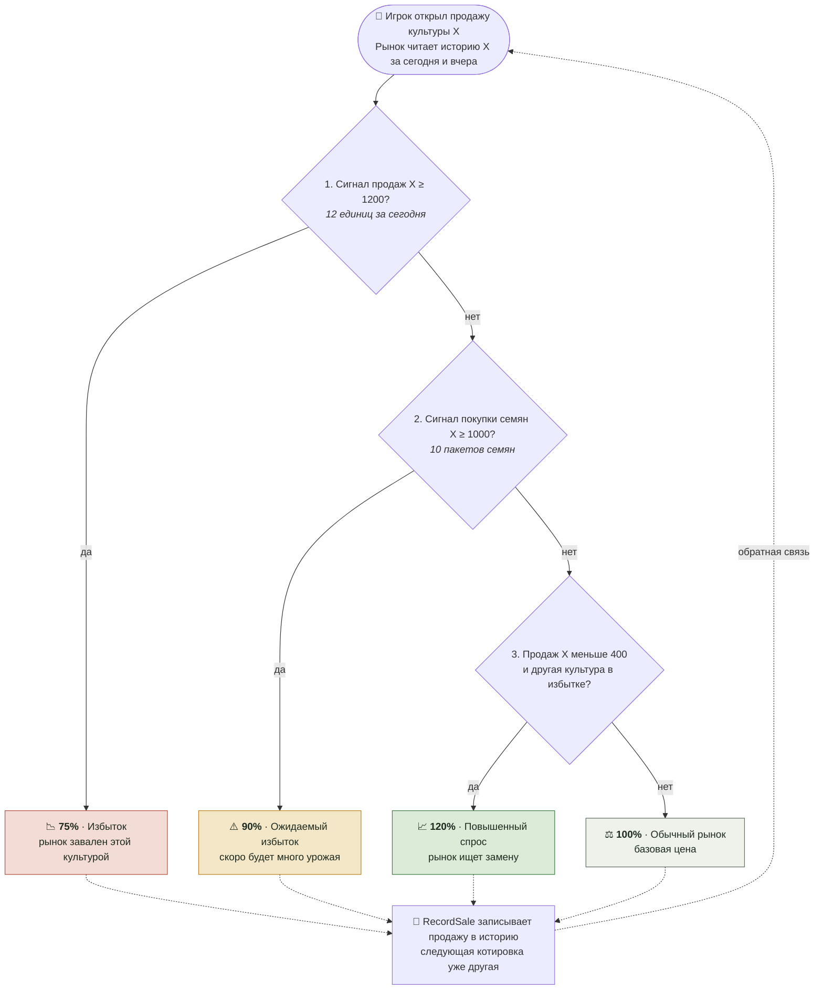
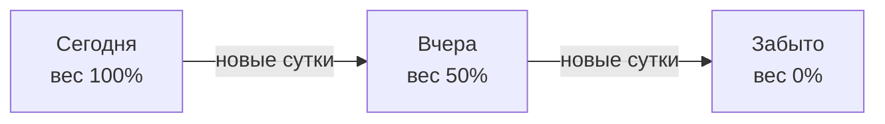
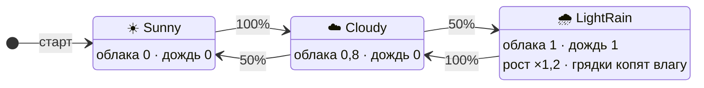
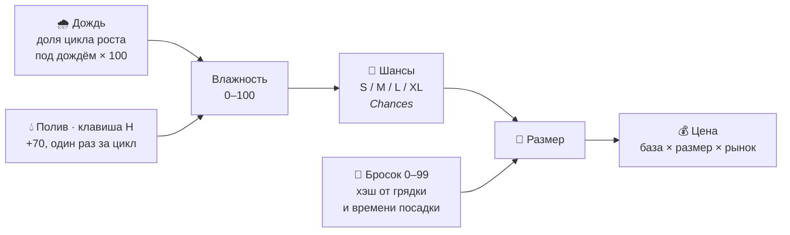
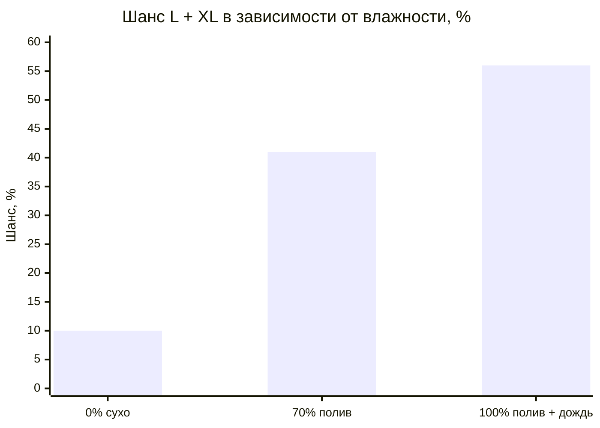
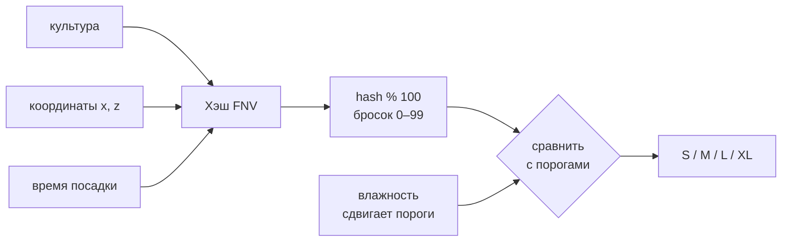

# 🌾 My Little Farm: адаптивный ИИ

> Шпаргалка к защите по предмету **«ИИ в играх»**: что мы добавили, как работает логика и какие скрипты открыть, чтобы показать каждую механику.

---

## 📌 Содержание

1. [Что сказать за 30 секунд](#-что-сказать-за-30-секунд)
2. [Схема 1 · Дерево решений рынка](#-схема-1--дерево-решений-рынка)
3. [Схема 2 · Конечный автомат погоды](#-схема-2--конечный-автомат-погоды)
4. [Схема 3 · Размер урожая и цена](#-схема-3--размер-урожая-и-цена)
5. [Детерминированный бросок](#-детерминированный-бросок)
6. [Скрипты по механикам](#-скрипты-по-механикам)
7. [Вероятные вопросы](#-вероятные-вопросы)

---

## 🎤 Что сказать за 30 секунд

Мы добавили в ферму три связанные системы. **Погода** работает как конечный автомат: солнце, облака и дождь сменяют друг друга. Дождь и полив повышают **влажность** грядки, а от неё зависит шанс вырастить урожай размера **L** или **XL**, который стоит дороже.

**Рынок** наблюдает за игроком. Дерево решений смотрит, сколько каждой культуры продали сегодня и вчера: если завалить рынок одной культурой, она дешевеет до **75%**, а культура, которой не хватает, дорожает до **120%**. Поэтому выгодно выращивать разные культуры.

---

## 🛒 Схема 1 · Дерево решений рынка

Метод `SalePriceRule` перед каждой продажей проверяет условия **сверху вниз**. Первое выполненное условие задаёт процент от базовой цены.

**Сигнал** = `продано сегодня × 100 + продано вчера × 50`

| Ветка | Условие | Цена | Почему |
|---|---|:---:|---|
| 📉 Избыток | продано ≥ 12 | **75%** | рынок завален культурой |
| ⚠️ Ожидаемый избыток | куплено ≥ 10 семян | **90%** | рынок «догадывается», что скоро будет много урожая |
| 📈 Повышенный спрос | своей мало (< 4), а другой много | **120%** | рынку нужна замена |
| ⚖️ Обычный рынок | ничего из выше | **100%** | без поправок |

> ✅ **Проверено в Unity:** после продажи 12 морковок морковь подешевела с **3 → 2** монет, а томат подорожал с **5 → 6**.

Пороги (12 / 10 / 4) и проценты (75 / 90 / 120) вынесены в класс `MarketBalance` и настраиваются в инспекторе Unity.

### Память рынка: два дня

При смене игровых суток `RotateActivity` переносит «сегодня» во «вчера» (вес 50%), а старые данные удаляет. Если игрок переключился на другие культуры, рынок восстанавливается.

---

## 🌦 Схема 2 · Конечный автомат погоды

У погоды **три состояния**. В каждом она держится **3–5 минут** (`holdSeconds` 180–300 с), затем за **45 секунд** плавно переходит в следующее. Из солнца и дождя путь всегда идёт через облачность, а из облачности игра бросает монетку.

| Состояние | Облака | Дождь | Куда дальше |
|---|:---:|:---:|---|
| ☀️ `Sunny` | 0 | 0 | → `Cloudy` (100%) |
| ☁️ `Cloudy` | 0,8 | 0 | → `Sunny` (50%) или `LightRain` (50%) |
| 🌧️ `LightRain` | 1 | 1 | → `Cloudy` (100%) |

**Эффект дождя:**
- растения растут быстрее: `GrowthMultiplier = 1 + 0,2 × дождь` (до +20%);
- грядка копит **влажность**, а от неё зависит размер урожая (см. схему 3).

---

## 🥕 Схема 3 · Размер урожая и цена

### Формулы шансов (метод `Chances`)

| Размер | Шанс | Цена |
|:---:|---|:---:|
| **S** | `55 − влажность / 2` | 50% |
| **M** | остаток до 100 | 100% |
| **L** | `8 + влажность × 0,28` | 120% |
| **XL** | `2 + влажность × 0,18` | 150% |

### Шансы при разной влажности

| Влажность | S | M | L | XL | **L + XL** |
|---|:---:|:---:|:---:|:---:|:---:|
| 🏜️ 0% · сухо | 55 | 35 | 8 | 2 | **10%** |
| 💧 70% · полив | 20 | 39 | 27 | 14 | **41%** |
| 🌧️ 100% · полив и дождь | 5 | 39 | 36 | 20 | **56%** |

---

## 🎲 Детерминированный бросок

**Простыми словами:** размер урожая не выбирается случайно в момент сбора, он заранее «запечатан» в грядке.

<table>
<tr><th>❌ Обычный Random</th><th>✅ Как сделано у нас</th></tr>
<tr><td>

Каждый сбор — новое случайное число.
Можно сохраниться, собрать, получить **S**, загрузиться и собирать снова, пока не выпадет **XL** (**«сейвскамминг»**).

</td><td>

Число берётся из **хэша** (формулы FNV) от:
- культуры (`carrot`);
- координат грядки (x, z);
- времени посадки.

Одинаковые данные дают одинаковый результат. Перезагрузка ничего не меняет.

</td></tr>
</table>

**Пример:** выпало число **70**.

| Грядка | Границы | Результат |
|---|---|:---:|
| 🏜️ сухая | S до 55, M до 90 | **M** |
| 💧 политая | S до 20, M до 59, L до 86 | **L** |

Число на «билете» фиксировано, но **полив и дождь сдвигают пороги**. Влиять на размер можно только честной игрой.

> 🗣️ **Фраза для защиты:** «Бросок размера мы делаем не через обычный Random, а через хэш от культуры, координат и времени посадки. Результат для каждой посадки фиксирован, поэтому нельзя перезагружаться ради XL. А полив и дождь меняют пороги шансов».

---

## 📂 Скрипты по механикам

Все пути от `Assets/_Game/Scripts/Runtime/Gameplay/`. Скрипты с логикой ИИ помечены суффиксом `_AI`.

| Механика | Файл | Что показать |
|---|---|---|
| 🛒 Дерево решений рынка | [`Economy/DailyMarketOrders.Activity_AI.cs`](../Assets/_Game/Scripts/Runtime/Gameplay/Economy/DailyMarketOrders.Activity_AI.cs) | `SalePriceRule`, `RecordSale`, `RotateActivity`, класс `MarketBalance` |
| 💰 Применение цены | [`Economy/FarmMarket_AI.cs`](../Assets/_Game/Scripts/Runtime/Gameplay/Economy/FarmMarket_AI.cs) | `AddItem` собирает цену и подпись, `Checkout` записывает продажу |
| 🥕 Размер урожая | [`Farming/HarvestQuality_AI.cs`](../Assets/_Game/Scripts/Runtime/Gameplay/Farming/HarvestQuality_AI.cs) | `Moisture`, `Chances`, `Select`, `Price` |
| 💧 Полив и дождь на грядке | [`Farming/CropSystem_AI.cs`](../Assets/_Game/Scripts/Runtime/Gameplay/Farming/CropSystem_AI.cs) | `TryWater`, `SampleRain`, `Moisture(crop)` |
| 🌦️ Конечный автомат погоды | [`World/WeatherController_AI.cs`](../Assets/_Game/Scripts/Runtime/Gameplay/World/WeatherController_AI.cs) | `enum WeatherState`, `NextState`, `RequestState`, `Update` |
| ✅ Отчёт с проверкой | [`Verification/AdaptiveAI/report.md`](../Verification/AdaptiveAI/report.md) | сценарий защиты и результаты из Unity |

---

## ❓ Вероятные вопросы

<b>Где здесь ИИ?</b>

Игра наблюдает за действиями игрока, анализирует их и меняет мир: цены зависят от того, что игрок продаёт и покупает. Это **моделирование игрока** плюс классические техники игрового ИИ: **дерево решений** и **конечный автомат**.

<b>Это минимакс?</b>

Нет. Минимакс ищет лучший ход в игре двух противников (как в шахматах). У рынка противника нет: он проверяет условия по очереди, это **дерево решений**.

<b>Почему рынок «помнит» только два дня?</b>

При смене суток `RotateActivity` переносит сегодняшние продажи во вчерашние с весом 50%, а старые удаляет. Рынок восстанавливается, если игрок переключился на другие культуры.

<b>Почему результат броска не случайный каждый раз?</b>

Бросок строится из хэша культуры, координат грядки и времени посадки. Так нельзя перезагрузить сохранение и «перебросить» урожай.

<b>Как это настроить?</b>

Пороги 12 / 10 / 4 и проценты 75 / 90 / 120 вынесены в `MarketBalance` и меняются в инспекторе Unity без правки кода.

---

Цикл адаптивного ИИ: <b>действие игрока → анализ истории → реакция мира</b>.
